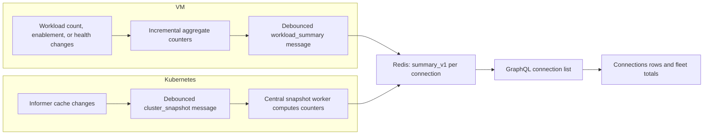
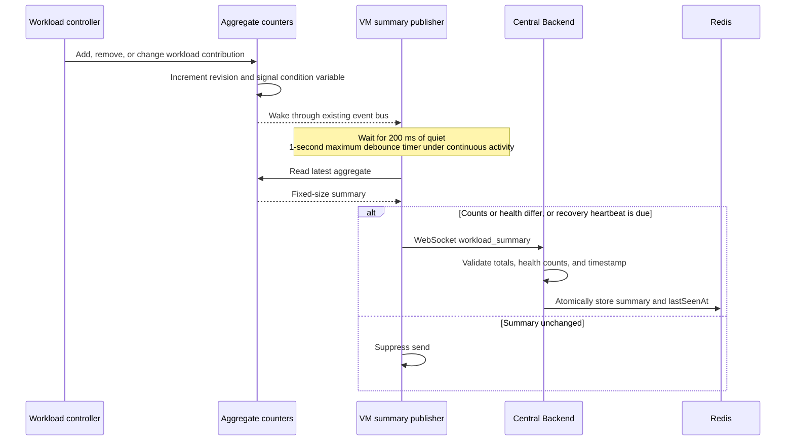
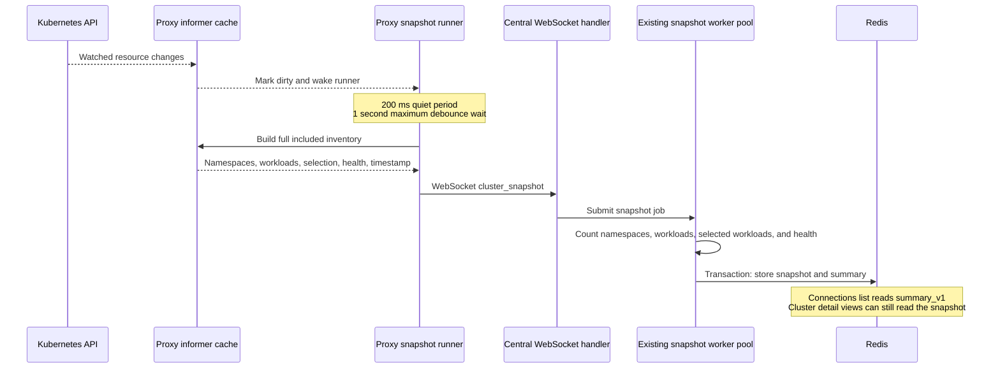
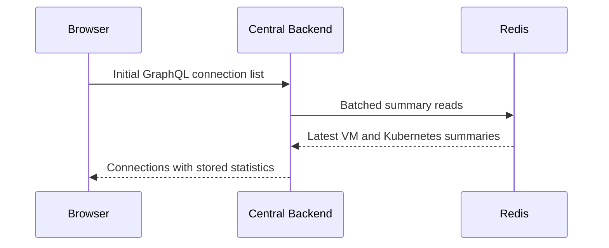

# How Central workload statistics work

This document describes workload statistics for VM Agent, the Kubernetes Central Proxy, Central Backend, and Central UI. The shared implementation ticket is [PLAT-1608](https://linear.app/odigos/issue/PLAT-1608/keep-vm-workload-statistics-current-in-central).

## The two paths meet at the same stored summary

VM Agent computes compact counters on the VM and sends those counters to Central. The Kubernetes proxy sends a full cluster inventory snapshot; Central derives its counters from that snapshot. Both end up in the same Redis summary field and use the same API statistics model.

The Connections list reads stored summaries. It does not parse every full Kubernetes snapshot each time the list is fetched. A VM summary does not create a fake Kubernetes inventory snapshot.

## What the numbers mean

A workload is an inventory entry, not a process or pod replica. On a VM, workloads are grouped by service name and kind; several PIDs can belong to one workload. In Kubernetes, the snapshot includes supported controller objects: Deployments, StatefulSets, DaemonSets, CronJobs, and OpenShift DeploymentConfigs, excluding configured ignored namespaces.

| Statistic | VM | Kubernetes |
| --- | --- | --- |
| `workloads` | All tracked workloads | All workload entries in the snapshot |
| `instrumentedWorkloads` | Workloads with a matching enabled source, excluding container-disabled workloads | Workloads whose snapshot has `selected: true`, currently determined by the presence of an InstrumentationConfig |
| `workloadsByHealth` | Fixed counters for Success, Error, Pending, and Waiting among enabled workloads | Counts of the proxy-reported health values among selected workloads |
| `namespaces` | Zero | Number of included namespaces |
| `autoInstrumentedNamespaces` | Zero | Namespaces selected through a namespace Source |
| `snapshotTimestamp` | Time the VM publisher sends the summary, in Unix seconds | Snapshot generation time, in Unix seconds; Central uses its receipt time as a fallback |

**Instrumented workloads includes workloads still waiting or rolling out.** It represents the selected/enabled population, not a count of successful attachments or proof of telemetry delivery.

Central converts the stored summary into `ComputePlatformStats`:

- `workloadsWithIssues = Error + Failure`.
- `workloadsInProgress = Pending + Waiting`.
- `updatedAt = snapshotTimestamp × 1000`, in Unix milliseconds.

Other Kubernetes health values remain in the stored health distribution but do not contribute to those two derived counts. Health counts exclude unselected/disabled workloads. `lastSeenAt` tracks connection activity separately; it does not prove a new inventory summary was generated.

## VM: update counters when state changes

The instrumentation controller stores each workload's previous health contribution inline. Creation adds a contribution, deletion removes it, and an enablement or health change subtracts the old contribution and adds the new one. Reading the aggregate copies a fixed-size struct under a read lock.

VM health classification applies in this order:

| State | Contribution |
| --- | --- |
| No matching source, source disabled, or container disabled | Excluded from instrumented and health counts |
| Error stage or report contains issues | Error |
| Waiting for rollout | Waiting |
| Pending, preparing, upgrading, or attaching | Pending |
| Enabled but not yet instrumented | Waiting |
| Otherwise | Success |

The publisher sends an initial summary for each connection, including reconnects. It checks again every **30 seconds** to recover missed notifications. Unchanged summaries are suppressed until a **5-minute recovery heartbeat** is due. The heartbeat is checked on that fallback tick.

Process-removal events normally update the controller directly. Cleanup is a separate safety net: small inventories get a pass every **5 seconds**. Larger inventories advance batches of up to **256 workloads and 256 eBPF PIDs**, scheduled every **100 ms** after the initial 5-second delay. Existing map iterators and fixed buffers avoid copying the entire inventory; a PID ownership index avoids scanning all workloads to find a process.

At 100,000 workloads, the workload iterator needs at least 391 batches: approximately 39 seconds of scheduling at 100 ms per batch, plus the initial delay and actual processing time. This bounds each batch's workload count, not its wall-clock execution time or the number of processes inside one workload. Normal event-driven reporting does not wait for that sweep.

The 200 ms debounce starts after a workload state change reaches the controller. Runtime discovery, reconciliation, network latency, and Central processing can add time; it is not a 200 ms guarantee from process creation to browser display.

## Kubernetes: summarize the inventory snapshot in Central

Kubernetes informers watch namespaces, supported workload controllers, Sources, and InstrumentationConfigs. Relevant additions, modifications, or deletions mark the proxy cache dirty. The runner uses a dirty flag and a coalesced wake-up, then builds the latest inventory from the informer cache.

The proxy sends its initial snapshot after the informer cache syncs. A **5-second safety-net check** tests the dirty state; it does not resend an unchanged snapshot on every tick. Kubernetes therefore also has a debounce and processing delay, even when updates appear immediate in the UI.

The existing Central Kubernetes snapshot worker pool has **10 workers and a queue capacity of 500 jobs**. This is an existing inventory-processing queue. VM summaries bypass it and are stored synchronously.

On backend startup, a backfill pass derives missing summaries from older stored Kubernetes snapshots. It writes only if the snapshot still exists and has no summary, preserving a concurrently stored newer summary. If a new snapshot cannot be summarized, Central stores its raw data and clears the previous summary rather than exposing stale counters for the new snapshot.

Existing cluster-scoped Kubernetes SSE events continue to serve cluster detail views.

## Redis and the Connections page

VM summaries use the existing `cluster-snapshot:<connection-id>` hash's `summary_v1` field. The snapshot data fields remain absent for VM connections. A transaction stores the summary and updates `proxy-meta:<connection-id>` / `last_seen_at`. Deleting a connection removes its stored summary with the snapshot hash.

The Connections page loads statistics through its initial GraphQL `GetComputePlatforms` query. Central reads the summaries in a batch and converts them into the existing `ComputePlatformStats` model. Count and health changes reach Redis while the page is open; the displayed statistics refresh on the next page load.

The VM-only publisher guard reflects the current connection model. Central does not accept the Docker platform type yet. ECS supports node and cluster connection paths, so ECS totals require a separate cluster aggregation design.

## Performance and failure boundaries

VM aggregate reads are O(1) in workload count. The local benchmark retained 1,000 and 100,000 workloads and measured **0 B/op and 0 allocs/op per summary read**. This does not mean that workload tracking, report generation, JSON serialization, or the entire agent allocates no memory.

Each Connections page load reads compact stored summaries. The unpaginated connection list still has fleet-wide cost. Kubernetes snapshot generation and summary computation still traverse that cluster's included inventory.

Debounce limits and cleanup batch sizes reduce avoidable work. They do not establish end-to-end capacity for 10,000 VMs or bound every processing delay. A fleet-scale load test remains outstanding. The existing Kubernetes snapshot queue can drop jobs when full. The proxy clears its dirty flag before snapshot generation, so a generation/send failure or a dropped worker job is not guaranteed to be retried by the 5-second check without another cache change. VM summary write failures stop that connection's publisher; a replacement connection sends a fresh initial summary. These paths are not durable event-replay mechanisms.

## Source map

- VM Agent counters and health classification: `pkg/components/controller/instrumentation/summary.go` in the VM Agent repository.
- VM Agent publisher timing and reconnect handling: `pkg/components/controller/central/summary.go` in the VM Agent repository.
- Summary storage: [redis/client.go](../internal/redis/client.go).
- Connection statistics conversion: [services/compute_platforms.go](../internal/services/compute_platforms.go).
- Summary computation for Kubernetes snapshots: [snapshotsummary/summary.go](../internal/snapshotsummary/summary.go).
