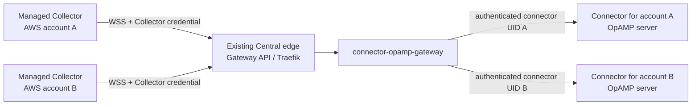

# Managed Collector OpAMP Routing

## Decision

Expose one public OpAMP endpoint for all remotely managed Collectors and route each authenticated
connection through a dedicated `connector-opamp-gateway` to the connector responsible for that
Collector's cloud account.

The endpoint is shared across AWS, Azure, and GCP:

```text
wss://<central-host>/v1/opamp
```

Do not create a public hostname, Ingress, or Gateway route for every connector. Do not proxy OpAMP
through the Central UI or a Next.js rewrite.

The `odigos-central` Helm chart should own the gateway workload and its optional external route. The
Central UI deployment itself has no OpAMP responsibility.

## Architecture



There are three routing layers:

1. The existing edge controller load-balances public connections across OpAMP gateway replicas.
2. The OpAMP gateway routes each connection by its authenticated connector UID.
3. The connector's Kubernetes Service sends the connection to its connector pod. Connector runtimes
   currently have one replica, so this final step is deterministic.

OpAMP is designed for many clients to connect to one server endpoint. Its default path is
`/v1/opamp`, it supports WebSocket and plain HTTP transports, and authentication occurs during the
HTTP handshake before a WebSocket upgrade. See the
[OpenTelemetry OpAMP specification](https://opentelemetry.io/docs/specs/opamp/).

## Component responsibilities

### Managed Collector

The connector deploying a Collector into a customer cloud account supplies:

```text
ODIGOS_OPAMP_ENDPOINT=wss://<central-host>/v1/opamp
ODIGOS_OPAMP_AUTHORIZATION=Bearer <collector-credential>
ODIGOS_CLOUD_CONNECTOR_ID=<connector-uid>
ODIGOS_MANAGED_COLLECTOR_ID=<collector-id>
ODIGOS_CLOUD_PROVIDER=<aws|azure|gcp>
```

All Collectors use the same endpoint. Their credentials determine which connector receives their
connections.

The existing [`supervisor.yaml`](./supervisor.yaml) already places the authorization header on the
OpAMP handshake and reports the connector ID in the Agent description.

For AWS, inject the credential through AWS Secrets Manager or the platform's native task-secret
mechanism rather than embedding it directly in a task definition. Azure and GCP should use their
corresponding managed secret mechanisms.

### Central edge

The edge terminates public TLS and forwards `/v1/opamp` to the `connector-opamp-gateway` ClusterIP
Service. It does not choose a connector.

For general Kubernetes installations, prefer an optional Gateway API `HTTPRoute` attached to an
existing customer-managed `Gateway`. Keep a standard `networking.k8s.io/v1` Ingress fallback.
Kubernetes recommends Gateway API for new work and has frozen the Ingress API; see the
[Kubernetes Ingress documentation](https://kubernetes.io/docs/concepts/services-networking/ingress/).

The application chart should not install an ingress controller. A customer may already use Envoy
Gateway, Traefik, an AWS load balancer controller, or another compatible implementation.

The bundled single-node Central deployment already uses Traefik for `/ws`, `/graphql`, `/sse`, and
the UI. Route `/v1/opamp` and `/v1/metrics` to the OpAMP gateway. The second route carries
authenticated OTLP/HTTP own telemetry configured through OpAMP. Traefik supports
WebSocket upgrades through ordinary HTTP routing without special upgrade annotations.

Operational edge settings must:

- Permit WebSocket upgrades and plain HTTP POSTs on `/v1/opamp`.
- Permit HTTP POSTs on `/v1/metrics`.
- Preserve the `Authorization` header.
- Use TLS for all external traffic.
- Set an idle timeout comfortably above the OpAMP heartbeat interval.
- Avoid proxy buffering for WebSocket traffic.
- Apply connection-attempt limits without using a low per-IP limit, because many Collectors may
  share a customer NAT address.

### `connector-opamp-gateway`

The gateway is a small, dedicated control-plane service. It should not be part of `central-ui`, and
keeping it separate from `central-backend` avoids coupling Collector-fleet scaling and failure modes
to browser authentication and GraphQL traffic.

During the initial HTTP/WebSocket handshake, the gateway:

1. Extracts and validates the Collector credential.
2. Resolves it to an immutable `collector_id` and `connector_uid` binding.
3. Confirms that the connector still exists and is enabled.
4. Confirms that the credential's provider/account association matches the connector.
5. Resolves the connector UID to its internal Kubernetes Service.
6. Reverse-proxies the connection to that connector's OpAMP port.

The gateway must route from authenticated credential state. It must not trust a connector ID from a
query parameter or the OpAMP Agent description. The Agent description arrives only after the
WebSocket has been upgraded and is client-controlled, so it is suitable only as a consistency check.

The gateway watches `OdigosCloudConnector` resources and connector Services and maintains an in-memory
lookup:

```text
connector UID -> namespace -> connector Service -> OpAMP port
```

Each gateway replica holds its own active WebSocket connections. After a gateway restart, a Collector
reconnects through another replica and resolves the same persisted identity binding.

**Implemented** in [`connector-opamp-gateway/`](../../connector-opamp-gateway). Five decisions the
implementation settled, each because the alternative fails in a way worth writing down:

**The credential table is `connector_platform.collector_credentials`, not a provider schema.** The
lookup key is the token hash, and the gateway must resolve a credential *before* it knows which
provider issued it — the provider is a column of the row it is looking for. A provider-schema table
would make every handshake a UNION across every provider and would need editing each time one is added.

**The credential stops at the gateway.** It is hashed on arrival and never forwarded. What crosses the
second hop is an identity — collector id, credential id, connector UID, provider, account, region,
network — on `X-Odigos-*` headers, defined once in
[`connectors/base/domain/collectorgateway`](../../connectors/base/domain/collectorgateway) so the
gateway and the connector's OpAMP server cannot hold different ideas of it. The credential id is there
because a rotation has two live credentials and the connector needs to know which one connected to
stamp `activated_at` on the right row.

The connector may trust those headers because a NetworkPolicy admits only gateway pods to its OpAMP
port. The gateway upholds the other half by stripping every inbound header in that namespace before
setting its own — a Collector that names its own connector must not be able to pick one. If that
boundary is ever weakened, the fix is to sign the assertion, not to re-send the credential: re-sending
would put a value worth the customer's destination credential on a second hop for no gain.

**Refusals are opaque; the reason goes to the log.** Every refused handshake is one status code and an
empty body. Telling "unknown credential" apart from "revoked" confirms to whoever is probing that a
token was once real, and a Collector cannot act on the difference. The one distinction made is `401`
(the credential is not acceptable) against `503` (the credential is fine, there is nowhere to route
it — connector deleted, terminating, or the store unreachable). Answering a store outage with `401`
would tell an entire fleet its credentials were invalid over a database blip.

**Revocation closes sessions that are already open.** Authenticating the handshake is not enough: an
OpAMP session lives for days and keeps receiving configuration pushes, each carrying the destination's
own credential, so refusing only the *next* handshake would leave a compromised holder connected for as
long as it avoided reconnecting. Every replica re-authorizes its open sessions on a timer (30s by
default) through the same decision function the handshake uses, and closes the ones that stopped being
acceptable. The sweep costs one read per *credential*, not per connection — N replicas of one Collector
share one credential, and that is normal, not a replay. A store outage during a sweep leaves sessions
open on purpose: closing them would disconnect the whole fleet, and every one of them would fail to
reconnect for the same reason.

**Routes come from the Service, not from recomputing its name.** The gateway resolves a connector's
OpAMP address from the Service labelled `odigos.io/connector-id=<CR UID>` exposing a port named
`opamp`. The naming rule lives in `connector-runtime`; a copy of it in the gateway would be correct
until the day it was not, and the failure would be a Collector routed at a name nothing answers on with
every component reporting healthy. Until that label and port exist, an authenticated Collector is
answered `503` and the reason is logged.

### Connector runtime

The provider connector remains the owner of account-specific desired Collector configuration and
runs the actual OpAMP server. Put the shared server implementation in `connectors/base` and use the
official [`opamp-go/server`](https://github.com/open-telemetry/opamp-go) package so AWS, Azure, and
GCP connectors share the transport and protocol implementation.

`connector-runtime` already uses the `OdigosCloudConnector` CR UID as the stable Central routing ID.
Extend its generated connector Deployment and Service with:

- An OpAMP container and Service port, normally `4320`.
- A label or annotation such as `odigos.io/connector-id=<CR UID>`.
- A NetworkPolicy allowing the OpAMP port only from `connector-opamp-gateway` pods.

The Service currently exposes only the connector GraphQL port; its builder is in
[`connector-runtime/internal/resources/resources.go`](../../connector-runtime/internal/resources/resources.go).

## Identity provisioning

When a connector deploys a managed Collector into a customer cloud account:

1. Central allocates a globally unique `collector_id`.
2. Central records the immutable association:

   ```text
   collector_id -> connector_uid -> provider/account
   ```

3. Central issues a credential bound to `collector_id` and `connector_uid`.
4. The connector securely installs the endpoint, identity, and credential in the remote workload.
5. The Collector connects to the shared Central endpoint.
6. The gateway authenticates the credential and routes the connection to the associated connector.
7. The connector sends the desired Collector configuration through OpAMP.

Multiple Collectors belonging to one cloud account receive distinct Collector identities and
credentials but resolve to the same connector UID.

## Credential design

An opaque random credential is the simplest first implementation. Persist only its hash:

```text
SHA256(token) | collector_id | connector_uid | provider | account_id | status | expires_at
```

This supports individual revocation and avoids putting authoritative routing information in the
public URL.

A signed JWT is also possible. It should contain narrowly scoped claims similar to:

```json
{
  "aud": "odigos-opamp",
  "sub": "<collector-id>",
  "connector_id": "<connector-uid>",
  "provider": "aws",
  "account_id": "123456789012",
  "exp": 1788200000,
  "jti": "<unique-token-id>"
}
```

The gateway must validate the signature, audience, expiration, revocation state, and current
connector ownership before upgrading the connection.

### Credential lifetime caveat

The managed Collector documentation currently describes the bearer credential as short-lived, but
[`supervisor.yaml`](./supervisor.yaml) sets `accepts_opamp_connection_settings: false`. The static
authorization header therefore cannot be rotated through OpAMP. Once a short-lived token expires,
the Collector will remain disconnected until its cloud workload is updated or restarted with a new
credential.

**Decided: the first release uses a long-lived, individually revocable opaque credential**, with
out-of-band rotation by redeployment. The full lifecycle — binding, persistence, the schema, the
rotation and revocation ordering, and the boundary cases — is specified in
[`connectors/MANAGED-COLLECTOR.md`](../../connectors/MANAGED-COLLECTOR.md) §6.3–6.4. In short:

- `expires_at` exists in the schema and is **NULL**. An expiry is refused unless something can replace
  the credential unattended, which today means automatic mode only, and refused below a 30-day floor
  because rotation is a deployment rather than an API call.
- Rotation is issue → write the secret → **redeploy** → await the new connection → revoke. Writing the
  secret alone rotates nothing: a running task holds the value injected at start.
- A compromise inverts that and revokes first, because the credential's holder can read the desired
  configuration, which carries the destination's own credential.
- Implementing OpAMP connection-credential rotation and enabling the Supervisor capability remains the
  path to genuinely short-lived credentials, and is what would let `expires_at` be used in manual mode.

Do not claim short-lived credentials until one of those rotation paths is implemented.

## Kubernetes and Helm ownership

Add a feature-gated section to the `odigos-central` chart, conceptually:

```yaml
cloudConnectors:
  managedCollectors:
    enabled: false
    externalEndpoint: ""
    gateway:
      replicas: 2
      resources: {}
    httpRoute:
      enabled: false
      parentRefs: []
      hostname: ""
      tls: {}
    ingress:
      enabled: false
      className: ""
      hostname: ""
      tls: {}
```

The chart should create, when enabled:

- `connector-opamp-gateway` Deployment and ClusterIP Service.
- ServiceAccount, minimal RBAC, and NetworkPolicy.
- Optional `HTTPRoute` or Ingress pointing one public route to the gateway.
- Gateway configuration containing the public endpoint passed to connectors when they deploy remote
  Collectors.

The chart should not create one route per `OdigosCloudConnector`, should not expose provider
connector Services publicly, and should not install a GatewayClass or ingress controller.

## Lifecycle behavior

- **Collector replacement:** persistent Supervisor state preserves its OpAMP instance UID. If it is
  intentionally replaced as a new logical Collector, issue a new `collector_id` and credential.
- **Gateway restart:** the WebSocket drops and the Supervisor reconnects through another gateway
  replica.
- **Connector restart:** its Collectors temporarily disconnect and reconnect through the shared
  endpoint when the connector becomes ready.
- **Connector deletion:** revoke **every live** credential — there are two during a rotation — before
  deleting the connector, not while. A task that outlives the delete call would otherwise keep an
  authenticated session open and keep being handed a configuration containing the destination
  credential. Subsequent connections fail authentication.
- **Connector recreation:** a recreated CR has a new UID. Old Collector credentials must not attach to
  the replacement connector automatically — a matching `collector_id` under a different `connector_uid`
  is a refusal, never a re-binding. The Collector's *infrastructure* is adopted by tag, but its
  credential is not inherited, so it stays disconnected until it is redeployed with a new one.
- **Credential compromise:** revoke the affected `collector_id` immediately, without disrupting other
  Collectors for the same account, and accept that this Collector's configuration plane is down until it
  is redeployed. A revoked credential is never reinstated; reinstating it hands it back to whoever took
  it.
- **Cloud provider expansion:** Azure and GCP use the same endpoint, credential format, gateway, and
  connector Service contract; only the provider deployment mechanism and desired configuration
  generation differ.

## Alternatives not selected

### One public route per connector

Having `connector-runtime` create an `Ingress` or `HTTPRoute` per connector would avoid a custom
router, but it would expose connector workloads more directly, create edge-resource churn, expand
RBAC and cleanup responsibilities, and still require authentication at every connector. It also
places routing identity in a public path or hostname. This is not recommended.

### OpAMP inside `central-ui`

The UI is a browser-facing presentation service and should not host long-lived binary protocol
connections. Next.js rewrites are also an unnecessary extra hop. This is not recommended.

### OpAMP inside `central-backend`

Embedding the first implementation in `central-backend` is technically possible, since that service
already handles long-lived proxy WebSockets. A dedicated gateway is preferred because Collector
fleet connectivity has independent authentication, scaling, timeouts, observability, and failure
characteristics.

### Central gateway terminates OpAMP permanently

A future design may terminate OpAMP completely in the gateway and retrieve desired configurations
from connectors through a database or internal API. That can remove the reverse-proxy hop, but it
also moves account-specific configuration coordination into a new central service. Keeping the OpAMP
server in `connectors/base` is the smaller change while provider connectors already own desired
configuration.

## Implementation checklist

1. ~~Define the Collector identity and credential database contract.~~ `collector_credentials`
   (migration `0011`) and `connectors/base/domain/collectorcredential`.
2. Implement credential **issuance** and revocation. The gateway validates and the schema is in place;
   nothing writes the table yet, which is the blocking dependency for a real deployment.
3. Add the shared OpAMP server to `connectors/base`.
4. Add the OpAMP port and connector UID label to connector Deployments and Services. Until this lands
   the gateway resolves no route and says so.
5. ~~Implement `connector-opamp-gateway` authentication, CR/Service watching, and WebSocket
   proxying.~~
6. Add gateway Deployment, Service, RBAC, NetworkPolicy, and values to the Central Helm chart.
7. Add an optional Gateway API `HTTPRoute` plus an Ingress fallback.
8. Add `/v1/opamp` to the bundled Traefik single-node edge configuration.
9. Inject the shared endpoint and per-Collector credential through each cloud provider's secret
   mechanism.
10. Test multiple accounts, multiple Collectors per account, connector deletion/recreation, gateway
    failover, connector restarts, expired/revoked credentials, and account-crossing attempts.
