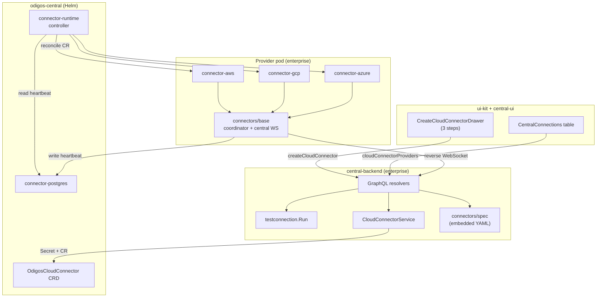

# Cloud Connectors — Feature Context & PRD

> **Purpose:** Source-of-truth context for engineers and Cursor agents working on Cloud Connectors.
> Covers architecture across **ui-kit**, **odigos**, and **odigos-enterprise**, historical delivery,
> current state, and planned work — with emphasis on the **Azure connector** ([enterprise#3263](https://github.com/odigos-io/odigos-enterprise/pull/3263)).

---

## What are Cloud Connectors?

Cloud Connectors let **Odigos Central** manage telemetry for workloads and compute platforms that live
**outside** a connected Kubernetes cluster — starting with AWS, GCP, and Azure.

Each connector instance owns one **account boundary**:

| Provider | Boundary        | Example account field                  |
| -------- | --------------- | -------------------------------------- |
| AWS      | Account ID      | `123456789012`                         |
| GCP      | Project ID      | `my-gcp-project`                       |
| Azure    | Subscription ID | `0ad05b43-fc39-4362-8bf1-e8bcef5792d9` |

Connectors appear on the Central **Connections** page alongside K8s proxy clusters and VM agents
(`platformType = "connector"`). Users create them through a 3-step wizard in the Central UI.

### Two domains (per provider)

Every provider spec declares capabilities in two **separate** hierarchies:

1. **Workloads** — directly instrumentable resources (e.g. Lambda, Cloud Run, Container Apps).

- **Discovery** — enumerate candidates as Odigos Sources
- **Instrumentation** — attach agents / env in place (requires an OTLP destination)

#### Who instruments a workload: automatic vs manual (IaC)

The two capability booleans above also decide **who applies** the instrumentation. A discovered workload
type is instrumented **by the customer by default**; the connector only does it itself when granted
instrumentation capability for that type:

| `discovery` | `instrumentation` | Mode | Behavior |
| --- | --- | --- | --- |
| `true` | `true` | `automatic` | Odigos applies, repairs and removes instrumentation. Needs provider mutation permissions. |
| `true` | `false` | `manual` (default) | The customer applies it via Terraform / CloudFormation / Bicep / CLI / by hand. Odigos observes and reports; it never mutates the workload. |
| `false` | — | — | Type not discovered at all. |

There is **no separate mode field** — on the CRD, in the GraphQL capability input, or in
`spec.Capabilities`. The mode is derived (`spec.Capabilities.WorkloadInstrumentationMode`), which also makes
it fail-safe across connector image versions: manual mode is `instrumentation: false`, so an older connector
image wires no reconciler for the type and cannot mutate a workload the customer chose to own.

Two resolvers follow from this, and picking the wrong one is the easiest mistake to make here:

- `ActiveInstrumentationTypes` — **automatic only.** The mutation gate. A reconciler is wired only for a
  type it returns, so a manual-mode type has no reconciler in the runtime at all (including during the
  shutdown drain).
- `InstrumentationTypes` — **either mode.** Reporting and availability. A manual-mode type must appear here
  so a marked workload reports as awaiting the customer's deployment rather than "no instrumentation
  defined".

A marked manual-mode workload reports `current.state: NotInstrumented` with a transient, non-error issue
coded `WaitingForCustomer`, and flips to `Instrumented` on its own once discovery observes an Odigos marker
on the applied workload — `ODIGOS_IAC`, written by the Odigos IaC artifact the customer applied, or
`ODIGOS_MANAGED` where the connector itself instrumented it. If the source is later disabled or deleted while
that instrumentation is still live, the workload reports `Error` with an issue coded
`SourceDisabledButInstrumented` / `SourceMissingButInstrumented` and `current.instrumented: true` — Odigos
will not strip instrumentation the customer applied, so removing it is theirs to do.

**Branch on `current.state` and `issues[].code`, never on `progress.stage`.** The first two are identifiers
and are stable; `progress.stage` is the reader-facing sentence for the same condition ("Waiting for you to
apply the instrumentation"), written for a person and free to be reworded. A client that matched on the
stage's old identifier spelling is matching on copy.

> **Behavior change.** Connectors already running with `discovery: true, instrumentation: false` previously
> reported a marked source as `Unknown` / `NoInstrumentationDefined` ("no instrumentation defined for this
> workload"). They now report the manual-mode states above. This is intended — that combination always meant
> "the customer instruments this" — but it is customer-visible. It is safe on the wire: `current.state` stays
> within the set central-ui decodes, and only the free-form `progress.stage` and issue codes change.

#### What the connector publishes for manual mode

Reporting a workload as "awaiting your deployment" is only useful if the connector can also say **what** to
deploy — and it is the only thing that can, because the desired state is computed from the same recipes its own
injector would apply. Nothing converges a manual-mode workload, so instructions written anywhere else would
drift from what the connector then judges the workload against, and the customer would apply them correctly and
be told their deployment is broken.

The desired state is modelled in `base/domain/plan` as an ordered set of **anchored fragments** — "add THIS at
THAT path" — rather than as a generated task definition or service object. A generated document would make
Odigos a second owner of something the customer's pipeline owns, and for the whole-object declarative platforms
it is not even expressible: Cloud Run and ARM/Bicep have no per-container or per-env-var child resource to
append to.

The part of that model worth knowing before touching it is **merge direction**. Loader variables
(`JAVA_TOOL_OPTIONS`, `PYTHONPATH`, `NODE_OPTIONS`) usually already carry a customer value, so a fragment
records how ours combines with theirs (`set` / `append` / `prepend` / `remove`) instead of a finished literal:

- a literal is correct only for the customer who has nothing set, and silently discards everyone else's value;
- the SIDE differs per platform for real reasons — Lambda **prepends** `PYTHONPATH` so the layer's
  OpenTelemetry packages resolve before the application's own, while the staged-agent platforms **append** so
  the customer's settings keep precedence — and getting it backwards fails nothing visibly;
- `remove` is a first-class instruction because conformance treats it as one: a variable the connector deletes
  (`OTEL_LOG_LEVEL`, Lambda's legacy `OTEL_EXPORTER_OTLP_*`) is compared against unset, so a workload still
  carrying it is reported as drifted.

Two delivery paths, and they are for different consumers:

| Path | What | Where |
| --- | --- | --- |
| Spec-declared artifacts | Per-type, per-tool copy-paste snippets (Terraform, CloudFormation, Bicep, gcloud, az-cli, aws-cli, plus a tool-agnostic reference) with `<UPPER_SNAKE_CASE>` placeholders | `spec/data/<provider>.yaml`, section `instrumentation:<type>`; surfaced by the existing `cloudConnectorProviders` catalog with no backend change |
| `instrumentationInstructions` query | The same change per WORKLOAD, **already rendered**: the artifacts with this workload's values substituted, plus the blanks that are still the customer's to fill | agents-api; served by `base/gql` from a provider `WorkloadPlanners()` registration |

`<...>` is deliberately **not** the `{{token}}` syntax the onboarding artifacts use: that one is substituted
client-side from create-connector form values and left verbatim when there is none, so a per-workload token
spelled that way reaches a customer as a literal `{{containerName}}` and reads as a rendering bug.

**The plan model does not cross the wire, and that is the design.** `base/domain/plan` is how the connector
decides what to write and what to judge a workload against; `base/domain/instrumentationplan` renders it to
text and that text is all a client gets. Fragments, merge directions, volumes, helper containers and layer
attachments stay internal — a client that acted on them would be a second implementation of this rendering,
free to disagree with the one that then reports the customer's deployment as drifted, and every new injection
mechanic would cost an agents-api version for internals nothing acts on. A provider that grows one now ships
it in the text it already owns.

Substitution therefore happens **connector-side**. The base resolves the reported service name, the region and
the OTLP endpoint in **both** the `host:port` and scheme-qualified forms — the SDK accepts a bare authority
and then exports nowhere, which is exactly the mistake a second substituting party would make. Values only a
provider can resolve — a container's name, a Lambda layer version ARN — come from its planner. Whatever is
left stays verbatim in the document and is reported in `unresolved` **with what belongs there**, derived from
the rendered text rather than from what the plan declares: that is the truth for a task definition packing
several applications, or for a Lambda layer Odigos does not publish yet, and reading it back off the text is
what keeps a client from being asked for a value its snippet does not contain.

`documents` is never empty. A type with no hand-authored per-tool snippet still gets one `manual` document
built from `plan.Prose` — the desired state is fully known either way, and a customer on an unsupported
toolchain needs the change described more than they need it in their own syntax.

**Two things a customer must get exactly right, and both were easy to miss:**

- **The marker is mandatory.** Attribution is derived from that variable alone, so a workload with every
  other fragment applied and no marker reports as awaiting the deployment forever — indistinguishable from an
  untouched one. Its recorded language (or, on Lambda, layer ARN) is also what conformance compares against.

  Which marker depends on who applies it, and the two are not interchangeable. A manual-mode customer sets
  `ODIGOS_IAC` (api.EnvOdigosIaC) — attribution, no snapshot, never mutated by the connector. `ODIGOS_MANAGED`
  is the connector's own record of a mutation it performed, including the rollback snapshot, and is written
  only in automatic mode; a customer must not hand-author it, because it claims a rollback nothing recorded.
  Readers accept either for "is this instrumented"; only `ODIGOS_MANAGED` grants the right to roll a workload
  back. Lambda publishes `ODIGOS_IAC` in its manual instructions today; the staged-agent platforms still
  publish `ODIGOS_MANAGED` and move over when their own IaC artifacts land.
- **On ECS, a pre-existing loader value must be recorded in the marker's `prevEnv`.** `containerDiff`
  reconstructs the expected value as `<recorded original> + separator + <Odigos value>`, so a customer who
  correctly appends to a value they did not record is reported as drifted for following the instructions.
  Cloud Run and Container Apps use a substring check and are unaffected.

The artifacts are hand-authored per tool — HCL, CloudFormation YAML and ARM share no syntax — so
`plan.CoverageProblems` is the guard that keeps them honest: a provider test asserts every literal a plan
requires appears in them, that every artifact carries the language-independent core, and that each artifact
states the merge DIRECTION next to the loader variable it names. That last check is the one a substring sweep
cannot make, because a template that hardcodes the loader value satisfies every literal check and is still the
bug. **When one of those tests fails, fix the recipe or update both sides — never edit a value in the YAML to
silence it.**

1. **Compute platforms** — managed environments where Odigos would be _installed_ (EKS, GKE, AKS, EC2, VM).

- **Discovery** — detect platforms
- **Installation** — deploy odiglet / VM agent (mostly **not implemented yet**; discovery-only in v1)

The provider YAML (`connectors/spec/data/<provider>.yaml`) is the **single source of truth** for
permissions, auth methods, UI fields, setup artifacts, and capability types. Both the UI and backend
consume it — no duplicated wire contracts.

---

## Architecture



### End-to-end create flow

1. **Step 1 — Select provider:** UI loads `cloudConnectorProviders` query → renders provider list,
   permission levels, custom capability toggles, and **policy preview** (IAM/RBAC templates from spec
   `setup.artifacts`).
2. **Step 2 — Setup credentials:** User picks auth method and fills credential fields.

- **Today (interim):** AWS still uses a hardcoded IAM wizard (`AwsCredentialsSections`); GCP/Azure use
  a generic renderer fed by spec fields ([damemi/ui-kit#1](https://github.com/damemi/ui-kit/pull/1)).
  ui-kit branches on `isAws` in `setup-credentials/index.tsx` — this is **not** the long-term design.
- **Target ([CORE-1389](https://linear.app/odigos/issue/CORE-1389/phase-2-spec-driven-create-cloud-connector-step-2-replace-isaws-fork)):**
  fully spec-driven Step 2 — auth methods, setup variants, create-role instructions, and credential
  fields all from `provider.auth.methods`, `connector.fields`, and `setup.artifacts` (see below).
- Credentials stay in browser memory only.

1. **Step 3 — Validate & create:** UI calls `testCloudConnectorConnection` then `createCloudConnector`.
2. **Backend validates in memory** via `connectors/testconnection` — identity, account match, discovery
   permissions. No Secret or pod yet.
3. **On success:** central-backend creates a K8s Secret (`<name>-credentials`) and upserts an
   `OdigosCloudConnector` CR.
4. **connector-runtime** (K8s controller) reconciles the CR → Deployment + Service for the provider pod.
   Stamps env vars from spec + Secret + `CONNECTOR_*_IMAGE` defaults.
5. **Provider pod starts:** verifies Postgres schema → registers heartbeat → runs discovery/reconcile
   loops → opens reverse WebSocket to central-backend.
6. **Status propagation:** controller reads `connector_platform.runtime_heartbeat` → updates CR
   conditions/phase → UI shows Connected / Error.

---

## Three-repo responsibilities

### ui-kit (`@odigos/ui-kit`)

**Role:** Presentation layer — drawer wizard, types, Storybook mocks. **No GraphQL/HTTP**; the host
app wires callbacks.

| Area                               | Key paths                                                |
| ---------------------------------- | -------------------------------------------------------- |
| Create drawer                      | `src/containers/_drawers/create-cloud-connector-drawer/` |
| Step 1 — provider + policy preview | `steps/select-provider/`                                 |
| Step 2 — credentials               | `steps/setup-credentials/`                               |
| Step 3 — validate                  | `steps/validate-connection/`                             |
| Form context                       | `src/contexts/cloud-connector-form-context.tsx`          |
| Types                              | `src/types/cloud-connectors/index.ts`                    |
| Connections table host             | `src/containers/central-connections/`                    |

**Host wiring (odigos-enterprise):**

- `central-ui/src/app/(v2)/(out-proxy)/connections/page.tsx`
- `central-ui/src/graphql/queries/cloud-connector-providers.ts`
- `central-ui/src/graphql/mutations/cloud-connector.ts`

**Release model:** ui-kit is published to npm; `central-ui` pins `@odigos/ui-kit` (currently `0.0.277`).

**Step 2 interim fork (to be removed by CORE-1389):**

```tsx
// ui-kit/src/containers/_drawers/create-cloud-connector-drawer/steps/setup-credentials/index.tsx
isAws ? <AwsCredentialsSections /> : <ProviderCredentialsSections />;
```

AWS sections 1–4 still use hardcoded `AUTH_METHODS`, `SETUP_METHODS`, and `IAM_ROLE_INSTRUCTIONS` in
`methods.ts`. GCP/Azure credential _fields_ come from spec, but the overall Step 2 layout is not yet
provider-agnostic.

---

### odigos (OSS repo)

**Role:** Kubernetes API + Helm packaging for Central infrastructure.

| Area                      | Key paths                                                                    |
| ------------------------- | ---------------------------------------------------------------------------- |
| CRD Go types              | `api/cloud-connectors/v1alpha1/`                                             |
| CRD YAML (Helm)           | `helm/odigos-central/templates/crds/odigoscloudconnectors.yaml`              |
| Feature gate + values     | `helm/odigos-central/values.yaml` → `cloudConnectors.*`                      |
| Connector infra templates | `helm/odigos-central/templates/connectors/`                                  |
| API docs                  | `docs/snippets/shared/api-reference/cloud-connectors.odigos.io.v1alpha1.mdx` |

**Helm gate:** `cloudConnectors.enabled: true` (default `false`) installs:

- `connector-runtime` Deployment (controller)
- Bundled PostgreSQL + PVC + migration Job
- `OdigosCloudConnector` CRD
- RBAC for central-backend to manage CRs/Secrets

**Provider image env vars** (stamped on `connector-runtime`, read by controller):

| Env var                 | Values key                    | Default image component             |
| ----------------------- | ----------------------------- | ----------------------------------- |
| `CONNECTOR_AWS_IMAGE`   | `cloudConnectors.aws.image`   | `odigos-enterprise-connector-aws`   |
| `CONNECTOR_GCP_IMAGE`   | `cloudConnectors.gcp.image`   | `odigos-enterprise-connector-gcp`   |
| `CONNECTOR_AZURE_IMAGE` | `cloudConnectors.azure.image` | `odigos-enterprise-connector-azure` |

Empty image overrides derive from global `imagePrefix` + `image.tag` via `utils.imageName` helper.

**Dependency direction:** odigos-enterprise imports CRD types from `github.com/odigos-io/odigos/api/cloud-connectors/v1alpha1` (local `replace => ../odigos` during dev).

---

### odigos-enterprise

**Role:** All runtime binaries, shared connector library, Central backend GraphQL, provider implementations.

| Area                                        | Key paths                                              |
| ------------------------------------------- | ------------------------------------------------------ |
| Shared library (spec, testconnection, base) | `connectors/` — see [README](./README.md)              |
| Provider specs                              | `connectors/spec/data/{aws,gcp,azure}.yaml`            |
| Provider runtimes                           | `connectors/providers/{aws,gcp,azure}/`                |
| K8s controller                              | `connector-runtime/`                                   |
| Postgres schema                             | `connector-postgres/migrations/`                       |
| Central GraphQL                             | `central-backend/graph/cloud-connector.*`              |
| CR/Secret creation                          | `central-backend/internal/services/cloud_connector.go` |
| Example CRs                                 | `connectors/examples/`                                 |

**Build targets:** `make build-connector-{aws,gcp,azure,runtime,postgres}` (see root `Makefile`).

**Module graph:** `connectors/` is a Go module imported by central-backend, connector-runtime, and each
provider runtime via local `replace`.

---

## Cross-repo dependency summary

```
ui-kit  ──npm──►  central-ui  ──GraphQL──►  central-backend
                                                    │
                                                    ├── imports connectors/spec, testconnection
                                                    ├── creates OdigosCloudConnector CR (odigos API types)
                                                    │
odigos (Helm + CRD) ──installs──► connector-runtime ──creates──► provider Deployments
                                                    │
                                                    └── imports connectors/spec (env stamping)
```

**Rule of thumb for changes:**

| Change type                                 | Primary repo                                         |
| ------------------------------------------- | ---------------------------------------------------- |
| New provider field, permission, auth method | `odigos-enterprise/connectors/spec/data/`            |
| UI for new field / artifact type            | `ui-kit` (+ bump in `central-ui`)                    |
| Test-connection logic                       | `odigos-enterprise/connectors/testconnection/`       |
| Provider discovery/instrumentation          | `odigos-enterprise/connectors/providers/<provider>/` |
| CRD schema change                           | `odigos/api/cloud-connectors/` + Helm CRD template   |
| Install/infra (postgres, images, RBAC)      | `odigos/helm/odigos-central/`                        |
| GraphQL API shape                           | `odigos-enterprise/central-backend/graph/`           |

---

## Delivery timeline

### Phase 0 — Foundation (merged)

| Item                                          | Repo       | PR / ticket                                                                                                              |
| --------------------------------------------- | ---------- | ------------------------------------------------------------------------------------------------------------------------ |
| OdigosCloudConnector CRD + initial Helm infra | odigos     | [#5195](https://github.com/odigos-io/odigos/pull/5195) CORE-1199, [#5249](https://github.com/odigos-io/odigos/pull/5249) |
| connector-runtime controller + AWS connector  | enterprise | [#3069](https://github.com/odigos-io/odigos-enterprise/pull/3069)                                                        |
| Create connector on verified connection       | enterprise | [#3113](https://github.com/odigos-io/odigos-enterprise/pull/3113)                                                        |
| Central UI connections page + create dropdown | ui-kit     | [#1067](https://github.com/odigos-io/ui-kit/pull/1067) PLAT-1271                                                         |
| Credentials + validate steps                  | ui-kit     | [#1068](https://github.com/odigos-io/ui-kit/pull/1068), [#1069](https://github.com/odigos-io/ui-kit/pull/1069)           |
| Connections list polish                       | ui-kit     | [#1070](https://github.com/odigos-io/ui-kit/pull/1070)                                                                   |

### Phase 1 — GCP + policy preview + multi-provider UI (merged)

| Item                                                                                        | Repo       | PR / ticket                                                                                                             |
| ------------------------------------------------------------------------------------------- | ---------- | ----------------------------------------------------------------------------------------------------------------------- |
| GCP connector + Cloud Run instrumentation                                                   | enterprise | [#3179](https://github.com/odigos-io/odigos-enterprise/pull/3179) CORE-1277                                             |
| Connector-agnostic policy preview (backend)                                                 | enterprise | [#3273](https://github.com/odigos-io/odigos-enterprise/pull/3273) CORE-1346                                             |
| Connector-agnostic policy preview (UI)                                                      | ui-kit     | [#1119](https://github.com/odigos-io/ui-kit/pull/1119) CORE-1346                                                        |
| Provider-specific credentials Step 2 (**interim** — Azure/GCP unblock; AWS assume-role fix) | ui-kit     | [damemi/ui-kit#1](https://github.com/damemi/ui-kit/pull/1) → `@odigos/ui-kit@0.0.277` — **to be absorbed by CORE-1389** |
| Wire GCP/Azure connector images in Helm                                                     | odigos     | [#5409](https://github.com/odigos-io/odigos/pull/5409) CORE-1390                                                        |

### Phase 2 — Azure connector (**in progress**)

| Item                            | Repo       | PR / ticket                                                                 | Status                          |
| ------------------------------- | ---------- | --------------------------------------------------------------------------- | ------------------------------- |
| Azure cloud connector (backend) | enterprise | [#3263](https://github.com/odigos-io/odigos-enterprise/pull/3263) CORE-1342 | **Open** — last PR in the stack |

### Phase 3 — Future / backlog

| Item                                                                   | Ticket                                                                                                                      | Notes                                                                                                                                 |
| ---------------------------------------------------------------------- | --------------------------------------------------------------------------------------------------------------------------- | ------------------------------------------------------------------------------------------------------------------------------------- |
| **Spec-driven Step 2** (replace `isAws` fork, YAML-only new providers) | [CORE-1389](https://linear.app/odigos/issue/CORE-1389/phase-2-spec-driven-create-cloud-connector-step-2-replace-isaws-fork) | Child of [CORE-1345](https://linear.app/odigos/issue/CORE-1345); see [Setup wizard phases](#setup-wizard-phases-core-1345-epic) below |
| Compute platform **installation** (EKS, GKE, AKS, EC2, VM)             | —                                                                                                                           | Discovery exists; reconciler stubs return NotImplemented                                                                              |
| Azure Workload Identity auth path                                      | —                                                                                                                           | Spec declares `workload-identity` method; service-principal is the tested path                                                        |
| External Postgres for connector state                                  | —                                                                                                                           | Helm bundles postgres today; no external-DB values yet                                                                                |
| Connector CR `spec.runtime.image` per-environment overrides            | —                                                                                                                           | Supported on CR; Helm defaults cover most cases post-CORE-1390                                                                        |

---

## Setup wizard phases (CORE-1345 epic)

> **Note:** Linear uses "Phase 1 / Phase 2" for the **setup-wizard generalization** work
> ([CORE-1345](https://linear.app/odigos/issue/CORE-1345/generalize-cloud-connector-ui-data-sections)),
> which is separate from the **feature delivery** phases above (Foundation → GCP → Azure → backlog).
> Design doc: [Cloud Connector Setup (Google Doc)](https://docs.google.com/document/d/16P_JpQMyaL3hTnVejB8DjTTmlJNbQlJ7GGlQaheeHa0/edit).

### Setup Phase 1 — Step 1 policy preview ✅ (CORE-1346, merged)

Step 1 permission preview is spec-driven via `setup.artifacts` in provider YAML.

- ui-kit [#1119](https://github.com/odigos-io/ui-kit/pull/1119)
- enterprise [#3273](https://github.com/odigos-io/odigos-enterprise/pull/3273)

### Setup Phase 2 — Step 2 credentials 🔜 (CORE-1389, backlog)

**Goal:** Make Step 2 fully provider-agnostic so adding/extending a provider is YAML-only — no
`isAws` / per-provider React forks. Explicitly **out of scope** for CORE-1389: Azure backend
([CORE-1342](https://linear.app/odigos/issue/CORE-1342)) — that track is independent.

**Step 2 sections — today vs target:**

| Section                       | Today                                                      | Target (CORE-1389)                                                |
| ----------------------------- | ---------------------------------------------------------- | ----------------------------------------------------------------- |
| 1. Authentication method      | Hardcoded `AUTH_METHODS` (AWS) or spec (GCP/Azure interim) | `provider.auth.methods` for all providers                         |
| 2. Setup method               | Hardcoded `SETUP_METHODS` (AWS only)                       | `setup.artifacts` variants                                        |
| 3. Create role / instructions | Hardcoded `IAM_ROLE_INSTRUCTIONS` (AWS only)               | `setup.artifacts` with `steps` + template                         |
| 4. Enter credentials          | Partly via `getCredentialFields` inside AWS flow           | Always spec-fed from `connector.fields` + `auth.methods[].fields` |

**One-time model additions** (spec + GraphQL + ui-kit):

- Extend `SetupArtifact` with `variant` / `variantLabel` (setup-method chooser)
- Add `steps: []string` (ordered instructions above snippet)
- Scalar template vars alongside `{{permissions}}`: `{{accountId}}`, `{{externalId}}`, `{{projectId}}`, `{{subscriptionId}}`, etc.
- Generic renderer: `renderSetupArtifact(artifact, { permissions, vars })`

**Follow-through work:**

- Remove the interim `isAws ? … : …` fork; absorb [damemi/ui-kit#1](https://github.com/damemi/ui-kit/pull/1)
- Move AWS create-role content (CFN / Terraform / CLI / manual) from `methods.ts` into `aws.yaml` `setup.artifacts`
- GCP/Azure: auth + credential fields already in YAML; add create-role artifacts only where needed
  (Azure service-principal path may **omit** setup-method and create-role sections 2–3)
- Delete legacy client-side IAM policy fallback in `permissions.ts` once all backends publish artifacts

**Acceptance criteria (from ticket):**

- [ ] Step 2 has no provider-name branching (`aws` / `gcp` / `azure`)
- [ ] Auth method segment renders from `provider.auth.methods` for all providers
- [ ] Credential/account fields render from `connector.fields` + `auth.methods[].fields`
- [ ] Setup method + create-role UI only appear when the provider declares matching `setup.artifacts`
- [ ] Interim damemi/ui-kit#1 fork removed or absorbed
- [ ] Azure / GCP / AWS create-connector flows work in Storybook + Central

**Repos touched:** primarily **ui-kit**; model extensions also in **odigos-enterprise**
(`connectors/spec`, GraphQL schema) to expose new artifact fields.

---

## Azure connector (current focus)

### Open PR

**[odigos-enterprise#3263](https://github.com/odigos-io/odigos-enterprise/pull/3263)** — `core-1342-azure-cloud-connector` → `main`

All prerequisite PRs are merged. This PR adds Azure-specific backend only.

### v1 surface

| Domain            | Type                   | Discovery | Instrumentation / Installation                     |
| ----------------- | ---------------------- | --------- | -------------------------------------------------- |
| Workloads         | `azure.container-apps` | ✅        | ✅ Init container + EmptyDir + activation/OTLP env |
| Compute platforms | `azure.aks`            | ✅        | ❌ Installation disabled (stub reconciler)         |
| Compute platforms | `azure.vm`             | ✅        | ❌ Installation disabled (stub reconciler)         |

### What's in the PR

- **Spec:** `connectors/spec/data/azure.yaml`
  - Subscription boundary, workload-identity + service-principal auth
  - `setup.artifacts` policy preview → custom RBAC role JSON with `{{permissions}}`
- **Schema:** `connector-postgres/migrations/0008_connector_azure.sql` (GCP owns `0007`)
- **Test connection:** `connectors/testconnection/azure.go` — typed `*azcore.ResponseError` summarization
- **Runtime:** `connectors/providers/azure/`
  - Container Apps detector + inventory (ARM resource ID as stable identity)
  - Container Apps instrumentor: `Get` → mutate template → `BeginUpdate`
  - Java / Python / Node.js / .NET via OSS k8s-init-container pattern
  - `ODIGOS_MANAGED` ownership + rollback on disable
  - AKS + VM detectors (discovery only)
- **Wiring:** `CONNECTOR_AZURE_IMAGE`, `ODIGOS_AZURE_SUBSCRIPTION_ID`, `ODIGOS_CONTAINERAPPS_AGENT_IMAGE`
- **Docs:** `connectors/providers/azure/README.md`, `connectors/examples/azure-connector.yaml`
- **UI dep:** bumps `central-ui` to `@odigos/ui-kit@0.0.277`

### Azure-specific design notes

1. **Regional identity:** Container Apps are regional; inventory key is the full ARM resource ID
   (`/subscriptions/.../providers/Microsoft.App/containerApps/...`), not the short app name.
2. **Subscription boundary:** One connector = one subscription. Startup verifies boundary; rebind to a
   different subscription purges inventory.
3. **Instrumentation prerequisite:** Container Apps instrumentor waits for an OTLP destination (same
   pattern as GCP Cloud Run).
4. **RBAC for v1 testing:** Custom role "Odigos Cloud Connector" with:

- `Microsoft.Resources/subscriptions/read`
- `Microsoft.App/containerApps/read`
- `Microsoft.App/containerApps/write`
- `Microsoft.App/managedEnvironments/join/action` (required to PATCH apps in a Container Apps Environment)

1. **Service principal setup:** Portal IAM picker may not find SP by Client ID — use display name,
   Enterprise App Object ID, or CLI:

### Known issues encountered in testing

| Issue                                           | Root cause                                                                               | Fix                                                                       |
| ----------------------------------------------- | ---------------------------------------------------------------------------------------- | ------------------------------------------------------------------------- |
| Connector CR `ImageUnresolved` for Azure        | Helm only set `CONNECTOR_AWS_IMAGE`                                                      | [#5409](https://github.com/odigos-io/odigos/pull/5409) — merged           |
| Postgres PVC Pending                            | Cluster had no default StorageClass                                                      | Set default SC or `cloudConnectors.postgres.persistence.storageClassName` |
| Step 2 sent `{}` credentials for Azure          | ui-kit Step 2 was AWS-only (pre-interim fix)                                             | damemi/ui-kit#1 — merged; **proper fix is CORE-1389**                     |
| AWS assume-role over-validation                 | Required static keys when role ARN set                                                   | damemi/ui-kit#1 — merged; may move to spec-driven validation in CORE-1389 |
| Instrumentation 403 `LinkedAuthorizationFailed` | SP had `containerApps/write` but not `managedEnvironments/join/action` on the linked CAE | Add `Microsoft.App/managedEnvironments/join/action` to the custom role    |

---

## Local development & testing

### Oddish (recommended)

Oddish (`~/oddish`) automates build/push/deploy for dev clusters:

- **Central install:** `bin/k8s/apply/odigos.sh` → selects "Central", sets `imagePrefix`, `image.tag`, optional `--set cloudConnectors.enabled=true`
- **Build targets:** connector-runtime, connector-postgres, connector-{aws,gcp,azure} in `bin/common/tools/docker.sh`
- **No Oddish changes needed for CORE-1390** — Helm derives GCP/Azure images from global `imagePrefix` + `image.tag` once chart includes the env vars

**Required:** `ODIGOS_ONPREM_TOKEN` exported in shell.

### Kind / manual

See provider READMEs:

- `connectors/providers/aws/README.md`
- `connectors/providers/gcp/README.md`
- `connectors/providers/azure/README.md`

Example CRs: `connectors/examples/`.

### ui-kit local iteration

During UI work, `central-ui` can pin ui-kit via **yalc** (local link) instead of npm version.
Do not commit yalc pins — bump `@odigos/ui-kit` version for merge.

### Verify a healthy connector

```bash
# CR status
kubectl get odigoscloudconnector -n odigos-central
kubectl get odigoscloudconnector <name> -n odigos-central -o yaml

# Infra pods
kubectl get deploy,pods -n odigos-central | grep connector

# connector-runtime env (should list all three CONNECTOR_*_IMAGE after CORE-1390)
kubectl get deploy connector-runtime -n odigos-central -o yaml | grep CONNECTOR_

# Provider pod logs
kubectl logs -n odigos-central -l odigos.io/provider=azure --tail=50
```

Expected progression: `ImageUnresolved` → Deployment created → heartbeat `Starting` → `Connected`.

---

## Onboarding a new cloud provider

Checklist (mirrors AWS → GCP → Azure pattern):

1. **Spec** — add `connectors/spec/data/<provider>.yaml` (boundary, auth, workloads, computePlatforms, setup.artifacts)
2. **Tests** — `connectors/spec/<provider>_spec_test.go`
3. **Test connection** — `connectors/testconnection/<provider>.go`, register in registry
4. **Postgres migration** — `connector-postgres/migrations/000N_connector_<provider>.sql`, bump `ExpectedSchemaVersions`
5. **Provider runtime** — `connectors/providers/<provider>/` implementing `base.Provider`
6. **Dockerfile + Makefile targets** — `build/load/push/deploy/restart/port-forward-connector-<provider>`
7. **connector-runtime** — env constant in `internal/resources/resources.go`, image map in `cmd/main.go`
8. **Helm** — `CONNECTOR_<PROVIDER>_IMAGE` + `cloudConnectors.<provider>.image` in odigos chart
9. **ui-kit** — provider icon/mock data; Step 2 should eventually be fully spec-driven ([CORE-1389](https://linear.app/odigos/issue/CORE-1389)) — do not add new `isAws`-style forks
10. **Example CR + README**

---

## Key files quick reference

### Spec (edit first for any provider change)

```
connectors/spec/data/aws.yaml
connectors/spec/data/gcp.yaml
connectors/spec/data/azure.yaml
connectors/spec/model.go
connectors/spec/load.go
```

### Controller & infra

```
connector-runtime/internal/controller/odigoscloudconnector_controller.go
connector-runtime/internal/resources/resources.go
helm/odigos-central/templates/connectors/connector-runtime-deployment.yaml   # odigos repo
helm/odigos-central/values.yaml                                                # odigos repo
```

### Central backend

```
central-backend/graph/cloud-connector.graphqls
central-backend/graph/cloud-connector.resolvers.go
central-backend/internal/services/cloud_connector.go
central-backend/internal/k8s/cloud_connector.go
```

### UI

```
ui-kit/src/containers/_drawers/create-cloud-connector-drawer/
ui-kit/src/contexts/cloud-connector-form-context.tsx
central-ui/src/app/(v2)/(out-proxy)/connections/page.tsx
```

---

## Linear tickets

| Ticket    | Title                                              | Status                                                                                               |
| --------- | -------------------------------------------------- | ---------------------------------------------------------------------------------------------------- |
| CORE-1199 | Initial connectors implementation                  | Done                                                                                                 |
| CORE-1277 | GCP cloud connector                                | Done                                                                                                 |
| CORE-1342 | Azure cloud connector                              | In PR [#3263](https://github.com/odigos-io/odigos-enterprise/pull/3263)                              |
| CORE-1345 | Generalize cloud-connector UI data sections (epic) | Todo — parent of CORE-1346 + CORE-1389                                                               |
| CORE-1346 | Setup Phase 1: policy preview (Step 1)             | Done                                                                                                 |
| CORE-1389 | Setup Phase 2: spec-driven Step 2 (`isAws` fork)   | Backlog — assigned Ben; branch `core-1389-phase-2-spec-driven-create-cloud-connector-step-2-replace` |
| CORE-1390 | Helm missing GCP/Azure connector image env vars    | Done [#5409](https://github.com/odigos-io/odigos/pull/5409)                                          |

---

## For Cursor agents picking up this work

1. **Read this file first**, then the relevant provider README and spec YAML.
2. **Spec changes drive everything** — start at `connectors/spec/data/`, run `go test ./connectors/spec/...`.
3. **Respect repo boundaries** — UI in ui-kit, CRD/Helm in odigos, runtime/backend in enterprise.
4. **The open Azure PR is enterprise-only** — [#3263](https://github.com/odigos-io/odigos-enterprise/pull/3263). UI and Helm prerequisites are already merged.
5. **Step 2 UI is interim** — do not treat `isAws ? AwsCredentialsSections : ProviderCredentialsSections` as the target architecture; follow [CORE-1389](https://linear.app/odigos/issue/CORE-1389) for Step 2 work (touches ui-kit + spec/GraphQL model extensions).
6. **Do not hand-edit generated files** (CRD codegen, GraphQL generated code).
7. **Testing a Central install** requires `ODIGOS_ONPREM_TOKEN` and `cloudConnectors.enabled=true`.
8. **Agent transcript** for the Azure debugging session: search agent transcripts for `CORE-1342`, `ImageUnresolved`, or cluster `ben-central-pro-plus`.

---

_Last updated: 2026-07-30 — aligned with [CORE-1389](https://linear.app/odigos/issue/CORE-1389) setup-wizard Phase 2 scope; merged ui-kit#1119, damemi/ui-kit#1, enterprise#3273, odigos#5409; open enterprise#3263._
