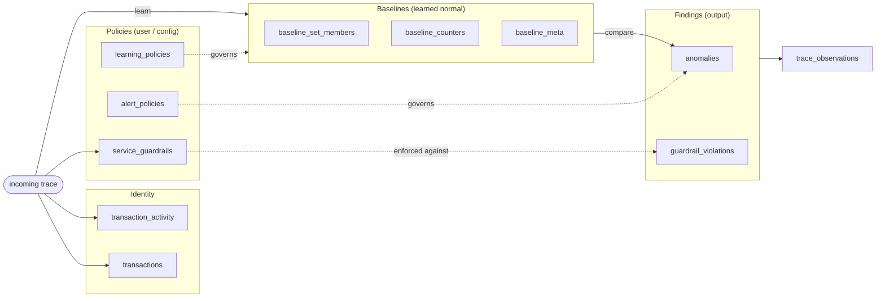

# Insights DB schema (ClickHouse)

How the tables relate, grouped by concern. Each table's engine is chosen so
ClickHouse does the cross-replica merge in the background instead of us locking
and rewriting rows.

## Identity & traffic

| Table | Engine | Responsible for |
|---|---|---|
| `transactions` | ReplacingMergeTree | One row per unique `(service, namespace, operation, kind)` - the stable transaction identity every other table keys off. |
| `transaction_activity` | AggregatingMergeTree | Per-transaction traffic counters (volume + last-seen), summed across replicas. Powers the "most active" ordering. |

## Baselines - the learned "normal", per (transaction, class)

| Table | Engine | Responsible for |
|---|---|---|
| `baseline_set_members` | ReplacingMergeTree | One row per learned member of a **set** class (D1 call edges, D2 egress, D5 libraries, D7 db access). The union across flushes/replicas is free and idempotent. |
| `baseline_counters` | SummingMergeTree | **Additive** class buckets (D8 payload-size histogram) as `(bucket, count)` deltas that ClickHouse sums. |
| `baseline_meta` | AggregatingMergeTree | Per-class scalars: observation count, promoted flag, learning start, stability markers. A class exists **iff** it has a meta row. |

## Policies - configuration, scoped global → service → transaction

| Table | Engine | Responsible for |
|---|---|---|
| `learning_policies` | ReplacingMergeTree | When a class graduates from learning to scored - the conditions and min-matches, per scope. |
| `alert_policies` | ReplacingMergeTree | When deviations fire an anomaly - the risk-score threshold, per-signal weight overrides, and enricher lists, per scope. |
| `service_guardrails` | ReplacingMergeTree | User-declared L7 allowlists (allowed callers / callees / egress) per service, each rule in enforce or suggest mode. |

## Findings - what an operator acts on

| Table | Engine | Responsible for |
|---|---|---|
| `anomalies` | ReplacingMergeTree(version) | One fired anomaly: triggered classes, risk score/severity, evidence, and lifecycle (open / accepted / dismissed). Re-inserted with a higher `version` to "update". |
| `guardrail_violations` | AggregatingMergeTree | Aggregate counter of guardrail breaks per `(service, rule, offending)`: occurrence count + lifecycle timestamps (open / dismissed / accepted / reopened). |

## Evidence

| Table | Engine | Responsible for |
|---|---|---|
| `trace_observations` | ReplacingMergeTree (120-day TTL) | Stored raw OTLP traces kept as examples (anomaly comparison, guardrail evidence), looked up by `sample_reason`. |

## Topology - service graph (blast radius)

| Table | Engine | Responsible for |
|---|---|---|
| `service_graph_edges` | ReplacingMergeTree(observed_at) | One row per `(client, server, connection_type, collector_pod)` directed edge, shipped from the gateway's servicegraph connector over OTLP. Keeps the latest cumulative counts per (edge, pod) - reads sum across pods. Backs the per-anomaly blast-radius subgraph (anomalous service's callers/callees, including virtual clients and uninstrumented dependencies). |
